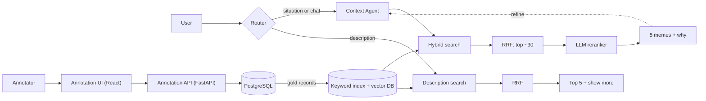
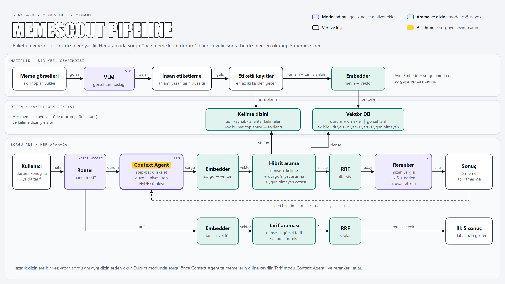

<div align="center">

# MemeScout

**An agentic meme assistant that understands Turkish situations and chats, finds memes that fit, and explains each pick.**

[](LICENSE)
[](https://github.com/tunadeniz1304/SENG_429/actions/workflows/pr-checks.yml)


[Overview](#overview) · [Getting Started](#getting-started) · [Usage](#usage) · [Architecture](#architecture) · [Contributing](#contributing)

</div>

---

## Table of Contents

- [Overview](#overview)
- [Features](#features)
- [Tech Stack](#tech-stack)
- [Getting Started](#getting-started)
  - [Prerequisites](#prerequisites)
  - [Installation](#installation)
  - [Configuration](#configuration)
  - [Running Locally](#running-locally)
- [Usage](#usage)
- [Testing](#testing)
- [Architecture](#architecture)
- [Project Structure](#project-structure)
- [Roadmap](#roadmap)
- [Contributing](#contributing)
- [Team](#team)
- [License](#license)

## Overview

MemeScout helps content teams and everyday users find a Turkish meme that fits a situation or a chat. Unlike plain semantic search, it looks at the feeling behind the message, not only the topic, and explains each pick.

This project is developed as part of the **SENG 429** course.

> **Status:** The search pipeline is designed (see [docs/architecture.md](docs/architecture.md)); the annotation platform is in development.

## Features

**Search** (designed, see [docs/architecture.md](docs/architecture.md))

- [ ] Situation or chat → meme: Router, Context Agent, hybrid search and an LLM reranker
- [ ] Description → meme: search by visual description and keywords
- [ ] A "why this meme" note for every result
- [ ] Refine loop: "daha alaycı olsun" (more sarcastic), "daha az kaba" (less crude)
- [ ] Content warning labels (political, crude, sensitive): flagged, never hidden

**Annotation platform** (in development)

- [x] API contract shared by frontend and backend ([openapi.yaml](annotation-platform/openapi.yaml))
- [x] Login and user management
- [x] Blind double labeling, review and gold records
- [x] Leakage check for test queries
- [x] Agreement and progress dashboards (API), audit log and JSONL export
- [x] "Bu mem kullanılmasın" vote and an admin pool to keep or exclude flagged memes

**Evaluation** (planned)

- [ ] Comparison with keyword search, plain semantic search, an LLM-free multi-vector baseline and a single-LLM baseline

## Tech Stack

| Layer          | Technology                                        |
| -------------- | ------------------------------------------------- |
| Frontend       | React, Vite                                       |
| Backend        | Python, FastAPI, SQLModel                         |
| Database       | PostgreSQL (SQLite in tests)                      |
| Search         | bge-m3 embeddings, Qdrant, LLM reranker (planned) |
| Infrastructure | Vercel (frontend and API), Supabase (PostgreSQL)  |
| Testing        | pytest                                            |

## Getting Started

### Prerequisites

- Python 3.11+ and pip
- Node.js 20.19+ or 22.12+ and npm
- Git

### Installation

```bash
git clone https://github.com/tunadeniz1304/SENG_429.git
cd SENG_429
pip install -r annotation-platform/backend/requirements.txt
npm install --prefix annotation-platform/frontend
```

### Configuration

The backend does not start without `DATABASE_URL`. For local development, create `annotation-platform/backend/.env` with:

```bash
DATABASE_URL=sqlite:///./memescout.db
```

Sign-up is closed by default. To allow it locally, also add `REGISTRATION_OPEN=1` to that file and `VITE_REGISTRATION_OPEN=1` to `annotation-platform/frontend/.env`.

The other backend settings and the meme import script are described in [annotation-platform/README.md](annotation-platform/README.md).

> [!WARNING]
> Never commit `.env` or any secret. It is ignored by `.gitignore`.

### Running Locally

```bash
uvicorn app.main:app --reload   # from annotation-platform/backend
npm run dev                     # from annotation-platform/frontend
```

## Usage

The annotation platform runs locally (see [Getting Started](#getting-started)); the search pipeline is designed in [docs/architecture.md](docs/architecture.md).

## Testing

```bash
pytest                          # from annotation-platform/backend
```

## Architecture

MemeScout has two parts. The annotation platform builds the labeled meme dataset. The search pipeline (designed, not implemented yet) reads that dataset from two indexes and answers queries. Details are in [docs/architecture.md](docs/architecture.md), [docs/annotation.md](docs/annotation.md) and the decision records in [docs/adr/](docs/adr/).



The full pipeline, including the preparation steps (in Turkish):



## Project Structure

```text
.
├── .github/              # CI workflows, PR/issue templates, CODEOWNERS
├── annotation-platform/  # Annotation platform for building the dataset
│   ├── backend/          # FastAPI API server and tests
│   ├── frontend/         # React + Vite annotation UI
│   └── openapi.yaml      # API contract shared by both sides
├── docs/                 # Architecture, annotation guide, ADRs, images
├── AGENTS.md             # Rules for AI coding agents
├── BRIEF.md              # Project brief
├── CHANGELOG.md
├── CONTRIBUTING.md
├── LICENSE
├── NOTICE
└── README.md
```

## Roadmap

Development is organized into phases. Each phase ends with a tagged release (`v0.<phase>.0`).

| Phase | Goal                                                            | Status      |
| ----- | --------------------------------------------------------------- | ----------- |
| P1    | Design: architecture, annotation guide, API contract            | Done        |
| P2    | Dataset: annotation platform, ~300 labeled memes, gold records  | In progress |
| P3    | Search pipeline: Router, Context Agent, hybrid search, reranker | Planned     |
| P4    | Evaluation and demo: test set, baselines, metrics, final report | Planned     |

See [open issues](https://github.com/tunadeniz1304/SENG_429/issues) for details.

## Contributing

`main` is protected: all changes go through a pull request with at least one approval.

- Branches: `P<phase>/<FeatureName>` (e.g. `P1/UserAuth`)
- PR titles: [Conventional Commits](https://www.conventionalcommits.org/) (e.g. `feat(auth): add login page`)

Read [CONTRIBUTING.md](CONTRIBUTING.md) for the full workflow before opening a PR.

## Team

| Name            | GitHub                                             |
| --------------- | -------------------------------------------------- |
| Tuna Deniz      | [@tunadeniz1304](https://github.com/tunadeniz1304) |
| Sena Nur Pekgöz | [@senanurpekgoz](https://github.com/senanurpekgoz) |
| Ceren Kızılay   | [@cerenkizilay](https://github.com/cerenkizilay)   |
| Esma Çalış      | [@esmaesss](https://github.com/esmaesss)           |

## License

Distributed under the Apache License 2.0. See [LICENSE](LICENSE) and [NOTICE](NOTICE).
